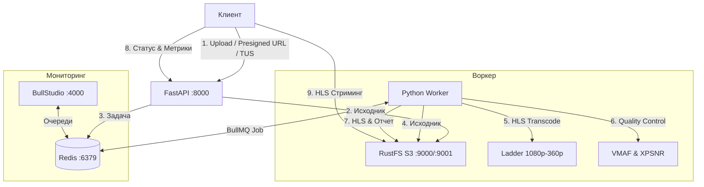

# Adaptive HLS Video Processing Pipeline

Распределенная система транскодирования видео в HLS (Adaptive Bitrate Streaming) с контролем качества (VMAF, XPSNR), очередями BullMQ, хранилищем RustFS S3 и дашбордом BullStudio.

---

## Стек технологий

- Python 3.11+ / FastAPI — REST API для загрузки, создания задач и получения результатов.
- TUS 1.0.0 — докачиваемая загрузка тяжелых исходников чанками с автоматической отправкой в S3 и постановкой задачи в BullMQ.
- BullMQ + Redis — очередь фоновых задач с распределением нагрузки, повторами и стримингом прогресса.
- BullStudio (`emirce/bullstudio`) — дашборд мониторинга очередей и задач BullMQ в отдельном контейнере.
- FFmpeg — генерация адаптивного потока HLS (`master.m3u8`, профили 1080p, 720p, 480p, 360p, сегменты `.ts`) с выравниванием GOP.
- Аппаратное ускорение (Hardware Acceleration) — автоопределение энкодеров: Apple Silicon/macOS (`h264_videotoolbox`), NVIDIA (`h264_nvenc`), Intel/AMD Linux (`h264_vaapi`), Intel QuickSync (`h264_qsv`), с безопасным фолбэком на `libx264`.
- Контроль качества:
  - VMAF — расчет через `ffmpeg-quality-metrics`.
  - XPSNR — расчет через фильтр FFmpeg `xpsnr` (каналы Y, U, V).
- RustFS S3 — объектное хранилище с S3 API (`rustfs/rustfs:latest`) и веб-консолью.
- Docker & Docker Compose — полная контейнеризация сервисов.

---

## Архитектура системы



---

## Структура проекта

```text
pipeline/
├── docker-compose.yml
├── Dockerfile
├── requirements.txt
├── .env.example
├── .env
├── README.md
├── src/
│   ├── config.py
│   ├── s3.py
│   ├── queue.py
│   ├── tus/
│   │   ├── __init__.py
│   │   └── manager.py
│   ├── ffmpeg/
│   │   ├── probe.py
│   │   ├── hls.py
│   │   └── metrics.py
│   ├── static/
│   │   └── index.html
│   ├── worker/
│   │   └── processor.py
│   └── api/
│       ├── main.py
│       ├── routes.py
│       ├── tus.py
│       └── schemas.py
└── scripts/
    ├── init_buckets.py
    ├── demo_client.py
    └── demo_tus_client.py
```

---

## Быстрый старт через Docker Compose

### 1. Запуск сервисов

```bash
docker-compose up -d
```

### 2. Сервисы

| Сервис | URL | Назначение |
|---|---|---|
| Web UI | [http://localhost:8000/](http://localhost:8000/) | Веб-интерфейс загрузки, плеера и метрик |
| FastAPI Swagger | [http://localhost:8000/docs](http://localhost:8000/docs) | REST API документация |
| BullStudio | [http://localhost:4000](http://localhost:4000) | Мониторинг BullMQ |
| RustFS Console | [http://localhost:9001](http://localhost:9001) | S3 консоль (`admin` / `adminpassword`) |
| RustFS S3 API | [http://localhost:9000](http://localhost:9000) | S3 эндпоинт |

---

## Запуск демо-скриптов

### 1. Тест multipart загрузки
```bash
.venv/bin/python -m scripts.demo_client
```

### 2. Тест докачиваемой TUS-загрузки чанками
```bash
.venv/bin/python -m scripts.demo_tus_client
```

---

## TUS 1.0.0 Resumable Uploads

Эндпоинт `/api/v1/tus` реализует протокол tus.io v1.0.0 для докачиваемой загрузки видеофайлов.

### Расширения протокола:
- `creation` — создание сессии через `POST /api/v1/tus`
- `creation-with-upload` — передача чанка в теле `POST`
- `termination` — отмена загрузки через `DELETE /api/v1/tus/{upload_id}`
- `HEAD /api/v1/tus/{upload_id}` — опрос смещения (offset) для возобновления
- `PATCH /api/v1/tus/{upload_id}` — передача чанков (`application/offset+octet-stream`)

По завершении загрузки файл сохраняется в бакет `videos-raw` хранилища RustFS S3, и создается задача BullMQ.

### Пример с tuspy (Python):
```python
from tusclient import client

tus_c = client.TusClient("http://localhost:8000/api/v1/tus")
uploader = tus_c.uploader(
    "source_video.mp4",
    chunk_size=5 * 1024 * 1024,
    metadata={"filename": "source_video.mp4"}
)
uploader.upload()
```

### Пример с tus-js-client / Uppy (JS):
```javascript
import * as tus from "tus-js-client";

const upload = new tus.Upload(file, {
    endpoint: "http://localhost:8000/api/v1/tus",
    retryDelays: [0, 1000, 3000, 5000],
    chunkSize: 5 * 1024 * 1024,
    metadata: {
        filename: file.name,
        filetype: file.type,
        hw_accel: "true",
        segment_duration: "4"
    },
    onProgress: (bytesUploaded, bytesTotal) => {
        console.log(`Progress: ${(bytesUploaded / bytesTotal * 100).toFixed(1)}%`);
    },
    onSuccess: () => {
        console.log("Upload finished:", upload.url);
    }
});
upload.start();
```

---

## REST API эндпоинты

### 1. Загрузка видео
- `POST /api/v1/jobs/upload` (`multipart/form-data`) — сохраняет в S3 и ставит задачу в BullMQ.
  Параметры: `file`, `segment_duration` (по умолчанию 4), `hw_accel` (по умолчанию `false`), `compute_quality_metrics` (`true`), `compute_vmaf` (`true`), `compute_xpsnr` (`true`).

### 2. Presigned URL
- `POST /api/v1/jobs/presigned` — выдает прямую ссылку загрузки в S3.

### 3. Задача для существующего ключа в S3
- `POST /api/v1/jobs` — создание задачи по `s3_key` с опциями (`segment_duration`, `hw_accel`, метрики).

### 4. Статус и прогресс
- `GET /api/v1/jobs/{job_id}` — шаг выполнения, процент и результат.

### 5. HLS воспроизведение
- `GET /api/v1/jobs/{job_id}/playback` — прямая ссылка на `master.m3u8` и Presigned URL.

### 6. Метрики качества (VMAF & XPSNR)
- `GET /api/v1/jobs/{job_id}/metrics` — отчет по разрешениям:
  ```json
  {
    "renditions": {
      "720p": {
        "profile": { "name": "720p", "width": 1280, "height": 720, "bitrate_k": 2800 },
        "metrics": {
          "vmaf": { "mean": 96.84, "min": 94.12, "harmonic_mean": 96.72 },
          "xpsnr": { "y_db": 44.52, "u_db": 47.10, "v_db": 46.85, "minimum_db": 43.90 }
        }
      }
    }
  }
  ```

---

## Локальная разработка

```bash
source .venv/bin/activate
uvicorn src.api.main:app --reload --port 8000
python -m src.worker.processor
```
