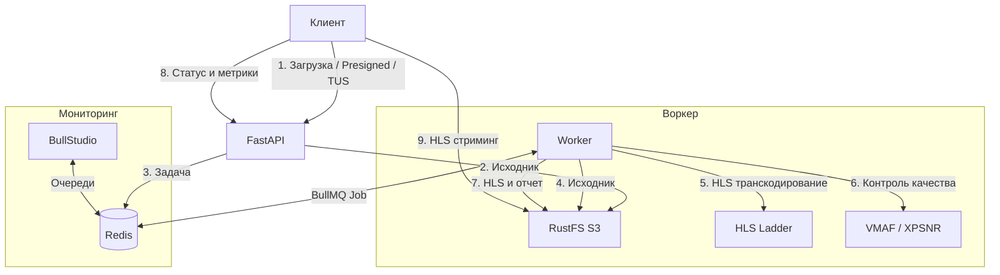

# Adaptive HLS Video Processing Pipeline

Распределенная система транскодирования видео в HLS с очередями BullMQ, S3-хранилищем и контролем качества (VMAF, XPSNR).

---

## Стек технологий

- **FastAPI** — REST API и TUS-эндпоинт
- **TUS 1.0.0** — докачиваемая загрузка чанками
- **BullMQ + Redis** — очередь фоновых задач
- **BullStudio** — дашборд мониторинга очередей
- **FFmpeg** — нарезка адаптивного HLS (1080p–360p) и аппаратное ускорение
- **VMAF & XPSNR** — оценка качества транскодирования
- **RustFS S3** — S3-совместимое объектное хранилище
- **Docker Compose** — контейнеризация

---

## Архитектура



---

## Структура проекта

```text
pipeline/
├── docker-compose.yml
├── Dockerfile
├── requirements.txt
├── pyproject.toml
├── .env.example
├── demo.py
├── src/
│   ├── config.py
│   ├── s3.py
│   ├── queue.py
│   ├── tus/
│   ├── ffmpeg/
│   ├── worker/
│   └── api/
├── scripts/
│   ├── demo.py
│   └── demo_utils.py
└── samples/
```

---

## Запуск через Docker Compose

```bash
docker compose up -d
```

| Сервис | URL |
|---|---|
| Swagger API | [http://localhost:8000/docs](http://localhost:8000/docs) |
| BullStudio | [http://localhost:4000](http://localhost:4000) |
| RustFS Console | [http://localhost:9001](http://localhost:9001) (`admin` / `adminpassword`) |
| RustFS S3 API | [http://localhost:9000](http://localhost:9000) |

---

## Демо-скрипт (TUS-загрузка)

```bash
.venv/bin/python demo.py [файл] [флаги]
```

### Флаги:
- `[input_file]` — путь к видеофайлу (по умолчанию генерируется `demo.mp4`).
- `-t, --duration` — длительность генерируемого видео в секундах (по умолчанию 60).
- `--hw` — аппаратное ускорение.
- `--vmaf` — расчет VMAF.
- `--xpsnr` — расчет XPSNR.

---

## TUS Загрузка

Эндпоинт `/api/v1/tus` реализует протокол TUS 1.0.0 (`creation`, `creation-with-upload`, `termination`).

```python
from tusclient import client

tus_c = client.TusClient("http://localhost:8000/api/v1/tus")
uploader = tus_c.uploader(
    "video.mp4",
    chunk_size=5 * 1024 * 1024,
    metadata={"filename": "video.mp4", "hw_accel": "true"}
)
uploader.upload()
```

---

## REST API

- `POST /api/v1/jobs/presigned` — Presigned URL для прямой загрузки в S3.
- `POST /api/v1/jobs` — создание задачи транскодирования по `s3_key`.
- `GET /api/v1/jobs` — список задач и прогресс.
- `GET /api/v1/jobs/{job_id}` — статус и результат задачи.
- `POST /api/v1/jobs/{job_id}/cancel` — отмена задачи.
- `DELETE /api/v1/jobs/{job_id}` — удаление задачи из очереди и Redis.
- `GET /api/v1/jobs/{job_id}/playback` — ссылки на `master.m3u8` и Presigned URL.
- `GET /api/v1/jobs/{job_id}/metrics` — метрики качества (VMAF, XPSNR).

---

## Локальный запуск

```bash
source .venv/bin/activate
pip install -r requirements.txt

# API
uvicorn src.api.main:app --reload --port 8000

# Воркер
python -m src.worker.processor
```
