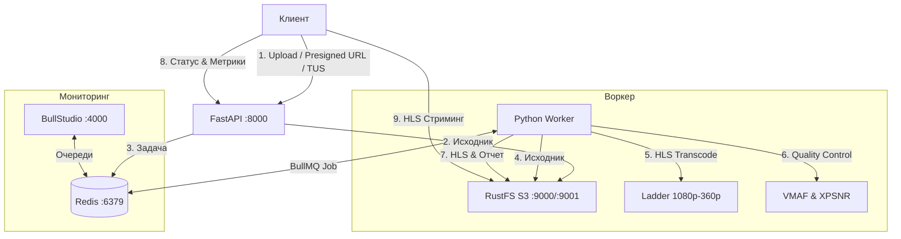

# Adaptive HLS Video Processing Pipeline

Распределенная система транскодирования видео в HLS (Adaptive Bitrate Streaming) с контролем качества (VMAF, XPSNR), очередями BullMQ, хранилищем RustFS S3 и дашбордом BullStudio.

---

## Стек технологий

- **Python 3.11+ / FastAPI** — REST API для загрузки, создания задач и получения результатов.
- **TUS 1.0.0** — докачиваемая загрузка тяжелых исходников чанками с автоматической отправкой в S3 и постановкой задачи в BullMQ.
- **BullMQ + Redis** — очередь фоновых задач с распределением нагрузки, повторами и стримингом прогресса.
- **BullStudio (`emirce/bullstudio`)** — дашборд мониторинга очередей и задач BullMQ в отдельном контейнере.
- **FFmpeg** — генерация адаптивного потока HLS (`master.m3u8`, профили 1080p, 720p, 480p, 360p, сегменты `.ts`) с выравниванием GOP.
- **Аппаратное ускорение (Hardware Acceleration)** — автоопределение энкодеров: Apple Silicon/macOS (`h264_videotoolbox`), NVIDIA (`h264_nvenc`), Intel/AMD Linux (`h264_vaapi`), Intel QuickSync (`h264_qsv`), с безопасным фолбэком на `libx264`.
- **Контроль качества**:
  - VMAF — расчет через `ffmpeg-quality-metrics` с покадровой и посекундной агрегацией.
  - XPSNR — расчет через фильтр FFmpeg `xpsnr` (каналы Y, U, V) с таймлайном.
- **RustFS S3** — объектное хранилище с S3 API (`rustfs/rustfs:latest`) и веб-консолью.
- **Docker & Docker Compose** — полная контейнеризация сервисов.

---

## Архитектура системы



---

## Структура проекта

```text
pipeline/
├── docker-compose.yml       # Декларация сервисов: API, Worker, Redis, RustFS, BullStudio
├── Dockerfile               # Мультистейдж-сборка с mwader/static-ffmpeg и Python 3.11-slim
├── pyproject.toml           # Метаданные пакета, конфигурация сборки и инструментов
├── requirements.txt         # Прямые зависимости проекта (с разбивкой по модулям)
├── requirements-lock.txt    # Полный детерминированный freeze всех транзитивных библиотек
├── .env.example             # Шаблон переменных окружения
├── .env                     # Локальная конфигурация среды
├── demo.py                  # Удобная кроссплатформенная точка запуска TUS демо-клиента
├── README.md                # Документация проекта
├── src/                     # Исходный код сервисов
│   ├── config.py            # Настройки на базе Pydantic Settings
│   ├── s3.py                # Клиент объектного хранилища S3 (Boto3)
│   ├── queue.py             # Очередь BullMQ и операции с Redis
│   ├── tus/                 # Бизнес-логика TUS (Manager, Upload metadata & storage)
│   │   ├── __init__.py
│   │   └── manager.py
│   ├── ffmpeg/              # Модули FFmpeg
│   │   ├── probe.py         # Извлечение метаданных видео через ffprobe
│   │   ├── hls.py           # Генерация адаптивного HLS с прогрессом и выравниванием GOP
│   │   └── metrics.py       # Расчет метрик VMAF и XPSNR с таймлайнами
│   ├── worker/              # Фоновый обработчик задач
│   │   ├── __init__.py
│   │   └── processor.py     # Обработка BullMQ Job: скачивание, транскодирование, QC, выгрузка
│   └── api/                 # FastAPI приложение
│       ├── __init__.py
│       ├── main.py          # Инициализация FastAPI, CORS, healthcheck и lifespan
│       ├── routes.py        # REST эндпоинты управления задачами и воспроизведением
│       ├── tus.py           # TUS 1.0.0 протокольный эндпоинт (/api/v1/tus)
│       └── schemas.py       # Pydantic модели запросов и ответов
├── scripts/                 # Вспомогательные скрипты
│   ├── demo.py              # Демо-клиент TUS загрузки и опрос статуса задач
│   └── demo_utils.py        # Парсинг аргументов CLI, генерация видео и форматирование таблиц QC
└── samples/                 # Локальные тестовые видеофайлы (исключены из git и Docker)
```

---

## Быстрый старт через Docker Compose

### 1. Запуск сервисов

```bash
docker compose up -d
# или для более старых версий Docker:
docker-compose up -d
```

### 2. Сервисы

| Сервис | URL | Назначение |
|---|---|---|
| FastAPI Swagger | [http://localhost:8000/docs](http://localhost:8000/docs) | REST API интерактивная документация |
| FastAPI Healthcheck | [http://localhost:8000/health](http://localhost:8000/health) | Проверка работоспособности сервиса |
| BullStudio | [http://localhost:4000](http://localhost:4000) | Мониторинг очередей и задач BullMQ |
| RustFS Console | [http://localhost:9001](http://localhost:9001) | S3 консоль (`admin` / `adminpassword`) |
| RustFS S3 API | [http://localhost:9000](http://localhost:9000) | S3 эндпоинт хранения видео |

---

## Запуск демо-скрипта (TUS-загрузка)

Для проверки работы пайплайна можно запустить демо-клиент:

```bash
# Через корневой скрипт
.venv/bin/python demo.py [path/to/video.mp4] [flags]

# Либо как модуль
.venv/bin/python -m scripts.demo [path/to/video.mp4] [flags]
```

### Флаги:
- `[input_file]` — путь к видеофайлу (опционально; например `samples/video.mov`. Если не указан, автоматически генерируется синтетический `demo.mp4`).
- `-t, --duration` — длительность генерируемого видео в секундах (по умолчанию: `60`).
- `--hw` — включить аппаратное ускорение транскодирования.
- `--vmaf` — включить расчет качества VMAF.
- `--xpsnr` — включить расчет качества XPSNR.

По умолчанию флаги оптимизаций и метрик выключены.

---

## TUS 1.0.0 Resumable Uploads

Эндпоинт `/api/v1/tus` полностью реализует протокол [tus.io v1.0.0](https://tus.io/protocols/resumable-upload.html) для надежной докачиваемой загрузки видеофайлов.

### Расширения протокола:
- `creation` — создание сессии через `POST /api/v1/tus`
- `creation-with-upload` — передача первого чанка непосредственно в теле `POST`
- `termination` — отмена и очистка сессии через `DELETE /api/v1/tus/{upload_id}`
- `HEAD /api/v1/tus/{upload_id}` — опрос текущего смещения (`Upload-Offset`) для возобновления после обрыва соединения
- `PATCH /api/v1/tus/{upload_id}` — передача бинарных чанков (`Content-Type: application/offset+octet-stream`)

По завершении загрузки файл сохраняется в бакет `videos-raw` хранилища RustFS S3, и создается задача BullMQ.

### Пример с tuspy (Python):
```python
from tusclient import client

tus_c = client.TusClient("http://localhost:8000/api/v1/tus")
uploader = tus_c.uploader(
    "source_video.mp4",
    chunk_size=5 * 1024 * 1024,
    metadata={"filename": "source_video.mp4", "hw_accel": "true"}
)
uploader.upload()
```

### Пример с tus-js-client / Uppy (JavaScript):
```javascript
import * as tus from "tus-js-client";

const upload = new tus.Upload(file, {
    endpoint: "http://localhost:8000/api/v1/tus",
    retryDelays: [0, 1000, 3000, 5000],
    chunkSize: 5 * 1024 * 1024,
    metadata: {
        filename: file.name,
        filetype: file.type,
        hw_accel: "true",
        segment_duration: "4"
    },
    onProgress: (bytesUploaded, bytesTotal) => {
        console.log(`Progress: ${(bytesUploaded / bytesTotal * 100).toFixed(1)}%`);
    },
    onSuccess: () => {
        console.log("Upload finished:", upload.url);
    }
});
upload.start();
```

---

## REST API эндпоинты

### 1. Сервисные
- `GET /` — общая информация о сервисе и ссылки на Swagger, TUS, BullStudio и S3 консоль.
- `GET /health` — проверка доступности API, настроек очереди и хранилища.

### 2. Presigned URL
- `POST /api/v1/jobs/presigned` — выдает прямую ссылку для быстрой загрузки в S3 без промежуточного TUS-проксирования.

### 3. Задача для существующего ключа в S3
- `POST /api/v1/jobs` — создание задачи транскодирования по `s3_key` с опциями (`segment_duration`, `hw_accel`, метрики).

### 4. Очередь и статус
- `GET /api/v1/jobs` — список задач со статусами, таймингами (`duration_seconds`, `processed_on`, `finished_on`) и процентом прогресса.
- `GET /api/v1/jobs/{job_id}` — текущий шаг выполнения, детальный прогресс, тайминги этапов и результаты.
- `POST /api/v1/jobs/{job_id}/cancel` — отмена активной или ожидающей задачи с прерыванием FFmpeg процесса.
- `DELETE /api/v1/jobs/{job_id}` — удаление задачи из очереди и Redis.

### 5. HLS воспроизведение
- `GET /api/v1/jobs/{job_id}/playback` — прямая ссылка на `master.m3u8` и Presigned URL для защищенного воспроизведения.

### 6. Метрики качества (VMAF & XPSNR)
- `GET /api/v1/jobs/{job_id}/metrics` — полный отчет по профилям и кросс-профильная матрица таймлайна:
  ```json
  {
    "renditions": {
      "720p": {
        "profile": { "name": "720p", "width": 1280, "height": 720, "bitrate_k": 2800 },
        "metrics": {
          "vmaf": {
            "mean": 96.84,
            "min": 94.12,
            "harmonic_mean": 96.72,
            "timeline": [{ "second": 0, "time_range": "00:00 - 00:01", "vmaf": 97.1 }]
          },
          "xpsnr": {
            "y_db": 44.52,
            "u_db": 47.10,
            "v_db": 46.85,
            "minimum_db": 43.90,
            "timeline": [{ "second": 0, "time_range": "00:00 - 00:01", "y_db": 44.6 }]
          }
        }
      }
    },
    "matrix": {
      "time_ranges": ["00:00 - 00:01", "00:01 - 00:02"],
      "renditions": ["1080p", "720p", "480p", "360p"],
      "grid": {
        "00:00 - 00:01": {
          "720p": { "vmaf": 97.1, "xpsnr": 44.6 }
        }
      }
    }
  }
  ```

---

## Локальная разработка

```bash
# Активация виртуального окружения
source .venv/bin/activate

# Установка зависимостей
pip install -r requirements.txt

# Запуск FastAPI сервера
uvicorn src.api.main:app --reload --port 8000

# Запуск фонового воркера
python -m src.worker.processor
```
