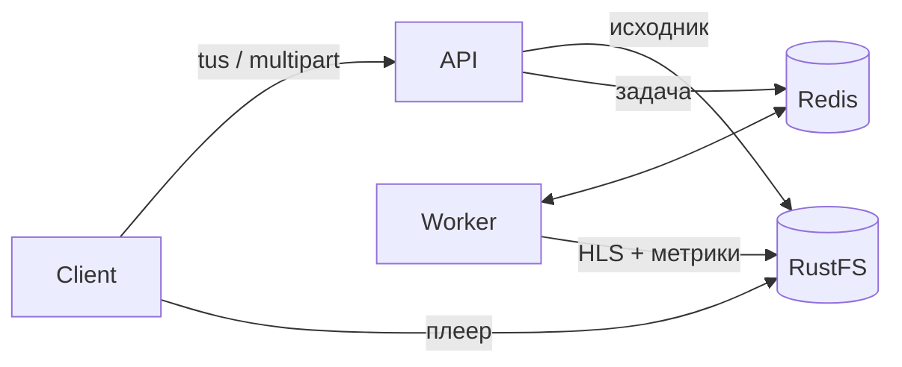

# HLS Pipeline

Видео → адаптивный HLS (1080p–360p) с оценкой качества VMAF и XPSNR.

FastAPI · tus · BullMQ/Redis · FFmpeg (+ HW-энкодеры) · RustFS S3



## Запуск

```bash
docker compose up -d
```

| | |
|---|---|
| UI | http://localhost:8000 |
| API docs | http://localhost:8000/docs |
| BullStudio | http://localhost:4000 |
| RustFS | http://localhost:9001 (`admin` / `adminpassword`) |

Демо: `python scripts/demo.py [--tus]`

## API

- `POST /jobs` — multipart: `file`, `segment` (4), `hw` (false), `vmaf` (true), `xpsnr` (true) → `{id}`
- `/tus` — tus 1.0.0; те же опции в `Upload-Metadata`; id задачи = id загрузки
- `GET /jobs/{id}` — `state`, `progress {step, pct}`, `result`, `error`

```json
{
  "playlist": "http://localhost:9000/hls/<id>/master.m3u8",
  "encoder": "libx264",
  "renditions": [
    {"name": "720p", "size": "1280x720", "kbps": 2800,
     "vmaf": {"mean": 96.8, "min": 94.1, "hmean": 96.7},
     "xpsnr": {"y": 44.5, "u": 47.1, "v": 46.9, "min": 43.9}}
  ]
}
```

`hw=true` выбирает первый доступный из `h264_videotoolbox`, `h264_nvenc`, `h264_vaapi`, `h264_qsv`, иначе `libx264`.

## Разработка

```bash
uvicorn app.api:app --reload
python -m app.worker
```
